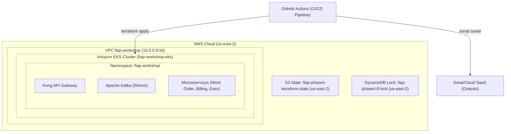

# Plano de Implementação: Adequação do EKS para AWS Free Tier (us-east-2)

> **Decisão do Usuário**: Migração para Nova Conta AWS Free Tier + SonarCloud Gratuito
> **Status**: Aprovado para Execução

---

## 1. Visão Geral da Demanda

Adequar a infraestrutura como código (IaC) do repositório `15soat-phase4-iac-k8s` para a nova conta AWS Free Tier do usuário (Região `us-east-2`, nova experiência baseada em projetos), desativando as dependências do ambiente restrito da AWS Academy (`use_existing_lab_role = false`) e delegando a análise de qualidade para o SonarCloud SaaS gratuito, mantendo o cluster EKS leve e dedicado estritamente aos microsserviços de negócio e mensageria.

---

## 2. Diagrama da Arquitetura Alvo

---

## 3. Roteiro Passo a Passo de Execução

### Fase 1: Atualização das Configurações de Região e Roles AWS
- **Arquivo `providers.tf`**:
  - Bloco `backend "s3"`: definir `region = "us-east-2"`.
- **Arquivo `variables.tf`**:
  - `aws_region = "us-east-2"`.
  - `use_existing_lab_role = false` (provisionar IAM roles oficiais gerenciadas pelo Terraform).
- **Arquivo `terraform.tfvars.example`**:
  - Refletir `aws_region = "us-east-2"`.
- **Workflow `.github/workflows/terraform.yml`**:
  - Fallback de `AWS_REGION` ajustado para `us-east-2`.

### Fase 2: Validação & Auditoria Sentinela
- Executar `terraform fmt -check`.
- Submeter a auditoria do subagente `Code Reviewer Sentinel` (**Diretriz Global #7**).
- Solicitar permissão explícita do usuário para commit e push (**Diretriz Global #1**).
